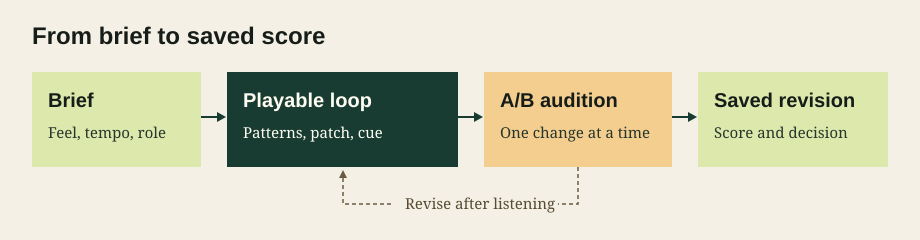

# Microhouse Livecoding

An independent production notebook for turning a microhouse brief into a playable Strudel score and saving what you learn from each take.

[Play the projects](https://jeremybboy.github.io/microhouse-livecoding/#projects) · [Browse synth presets](docs/presets/) · [Read the agent skill](skills/microhouse-producer/SKILL.md)

Write down the intended feel, build a short loop, listen to one change at a time, and save the score with the decision.

## Start with the two tests

[**Test 1 · Triangle keys**](docs/projects/test-1.strudel) and [**Test 2 · FM keys**](docs/projects/test-2-fm-keys.strudel) are two voices for the same six-minute arrangement, *Between the Steps*. Open them from the workflow site or paste the source into [Strudel](https://strudel.cc/). Set `cueBar` to `33` for the first chord passage or `97` for the full groove. Both scores use 122 BPM and a dry sine sub.

## Make another take

- Use the [production method](docs/method.md) to translate a brief into track roles and an audition plan.
- Read the [score structure](docs/architecture.md) for the signal chain, section map, and live cue.
- Give a coding agent the [Microhouse Producer skill](skills/microhouse-producer/SKILL.md) and the path to a baseline score.
- Save new versions as `.strudel` in a dedicated branch. See [contributing](CONTRIBUTING.md), [repository instructions](AGENTS.md), and [agent navigation](docs/llms.txt).

This repository ships original score code, documentation, and worked presets under [MIT](LICENSE). Strudel and the samples loaded by its editor follow their respective upstream licenses.
